# OCR Automated Scoring Project based on Python Implementation: Source Code for Answer Card Automated Scoring + Project Description

This project serves as the README introduction for the Dachuang Integrated Warehouse. The warehouse is designed to complete each module according to a flowchart, leaving behind input and output interfaces and documentation. The README explains the principles of this project, its implementation methods, and ways to reproduce it.

### 1 Overall flowchart

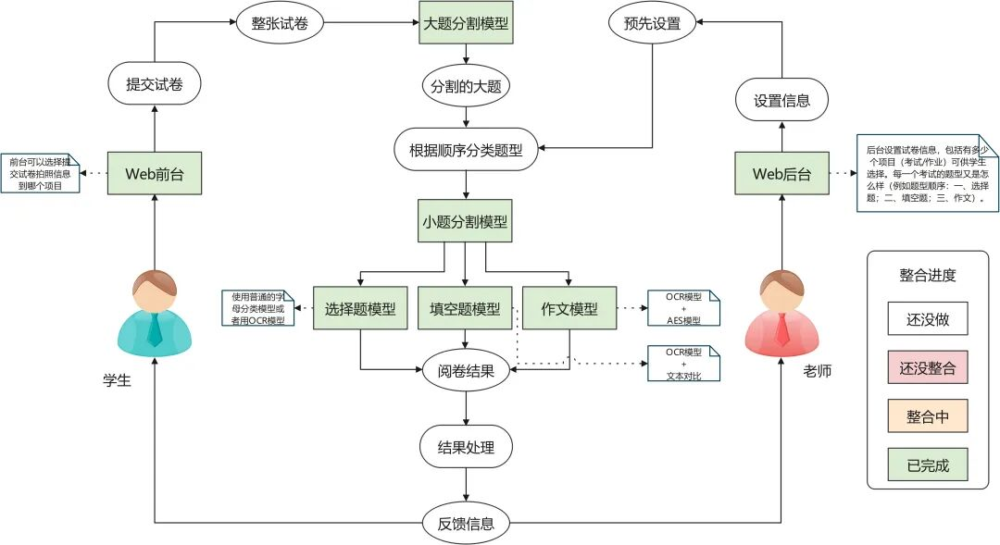

Insert image description here.

### 2. Module Development Standards

Example, similar to the `scoreblocks/fillblankmodel.py` file, create a class. In practice, we instantiate this class and load the models used in its `__init__` method (no need to load them each time we call). Then use various member functions of the class to implement functionality. The `if __name__ == "__main__":` in the py file can be used for testing. Both English and Chinese comments are acceptable for class and function annotations.

```
import paddleocr
import numpy as np
from PIL import Image
import torch
from transformers import CLIPProcessor, CLIPModel
debug = False
class model:
def __init__(self, language:str="en"):
"""
:parameter language: the language of the text, `ch`, `en`, `french`, `german`, `korean`, `japan`, type: str
"""
self.ocr = paddleocr.PaddleOCR(use_angle_cls=True, lang=language)
self.device = torch.device("cuda" if torch.cuda.is_available() else "cpu")
self.clip_model = CLIPModel.from_pretrained("openai/clip-vit-large-patch14").to(self.device)
self.clip_processor = CLIPProcessor.from_pretrained("openai/clip-vit-large-patch14", device=self.device)
def recognize_text(self, _img:Image):
"""
Predict the text from image
:parameter img: image, type: np.ndarray
:return: result, type: tuple{location: list, text: str}
"""
img = np.array(_img)
result = self.ocr.ocr(img)
if debug:
print(result)
if len(result[0]) == 0:
return None
else:
location = result[0][0][0]
text = result[0][0][1][0]
return (location, text)
def judge_with_clip(self, _answer:str, _predict:str, _img:Image):
"""
Use clip to judge which one is more similar to the Image
:parameter answer: the answer text, type: str
:parameter predict: the predict text, type: str
:parameter img: image, type: np.ndarray
:return: result, the index of the more similar text, type: int
"""
image = _img
inputs = self.clip_processor(text=[f"A picture with the text \"{_answer}\"", f"A picture with the text \"{_predict}\""
"A picture with the other text"], images=image, return_tensors="pt", padding=True)
inputs.to(self.device)
outputs = self.clip_model(**inputs)
logits_per_image = outputs.logits_per_image  # this is the image-text similarity score
probs = logits_per_image.softmax(dim=1)  # we can take the softmax to get the label probabilities
if debug:
print(probs)
index = torch.argmax(probs, dim=1)
return index
if __name__ == "__main__":
"""
For testing functions
"""
debug = True
import paddle
print(paddle.device.is_compiled_with_cuda())
model = model()
while True:
img_path = input("Please enter the image path: ")
answer = input("Please enter the correct answer: ")
img = Image.open(img_path)
predict = model.recognize_text(img)[1]
print("Prediction result: ", predict)
if (predict != answer):
print("Correct result:", answer)
index = model.judge_with_clip(answer, predict, img)
print("Judgement Result: ", (answer, predict, "error")[index])
```

### 3 File Directory Explanation

```
OCRAutoScore
+----scoreblocks # Fill-in-the-blank, multiple-choice, essay correction model folder
CharacterRecognition
+----SpinalVGG.pth # SpinalVGG model
+----WaveMix.pth # WaveMix model
+----example # Test Image
fillblank_testdata # Fill in the blank test image
MSPLM # AES model
esaayscoremodel.py # essay scoring model
FillBlankModel.py # Fill-in-the-blanks correction model
+----singleCharacterRecognition.py # Single Character Recognition Model
+----score_web # Frontend Web Folder
Components | Front-end components
pages | page
Routes | # Routes
+----score_server # Backend Folder
index
+----models.py # database model
+----urls.py # Interface file
+----views.py # View handling function
+----CAN # Conflict Identification in the CAN Model
+----README.assets # README's image folder
+----README.md # Repository Description File
+----.gitignore # Git ignores folders and files
```

## 4 Response Area Division - Major Task Separation

In the section on large-scale tasks, we utilized the YOLOv8 model and trained it using the dataset provided by the teacher, ultimately achieving a highly perfect result.

### 4.1 YOLOv8

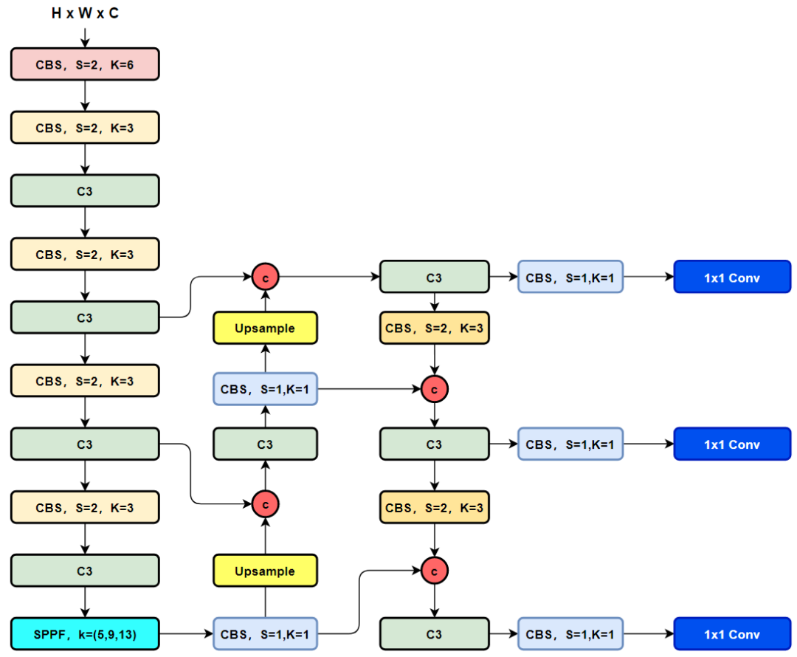

Insert image description here.

YOLOv8 is an efficient algorithm that includes image classification, Anchor-Free object detection, and instance segmentation. The detection part designs reference the current large number of excellent latest YOLO improvements, achieving a new SOTA. YOLOv8 abandons the Anchor-Base of previous generations, which is a target detection system based on global image information.

Compared with its predecessor, YOLOv8 has the following differences:

1.

1. A brand-new SOTA model is provided, including target detection networks with P5 640 and P6 1280 resolutions as well as instance segmentation models based on YOLACT. Like YOLOv5, different sizes of N/S/M/L/X scale models are also provided, meeting the needs of different scenarios according to the scaling factor.

1.

2. The backbone network and the neck part may have referenced the design concept of YOLOv7 ELAN. In YOLOv5, the C3 structure was replaced with the C2f structure that has richer gradient flowability. Different channel numbers were adjusted for different scale models, and fine-tuning rather than blindly applying a set of parameters to all models significantly improved model performance. However, some operations (such as Split) in this C2f module are not as suitable for specific hardware deployments as before.

1.

3. Compared with YOLOv5, there is a significant change in the Head part. The classification and detection heads are separated by adopting mainstream decoupling head structure, and moving from Anchor-Based to Anchor-Free.

1.

4. In terms of loss calculation strategies, the Task-Aligned Assigner positive sample allocation strategy and Distribution Focal Loss are adopted.

1.

5. During data augmentation during training, introducing the Mosaic augmentation operation after 10 epochs of YOLOX can effectively improve accuracy.

YOLOv8, as a real-time object detection algorithm, may be applied in various scenarios, including but not limited to:

-

• Autonomous vehicles: Real-time detection of pedestrians, vehicles, traffic signals, and other targets on the road, providing critical information for autonomous driving systems.

-

• Video surveillance: Real-time detection and tracking of abnormal behaviors in the security system, such as trespassing or theft.

-

• Industrial Automation: Used in fields such as product quality testing and robot navigation.

-

• Drone aerial photography: real-time target detection and tracking, providing drones with navigation and obstacle avoidance capabilities.

Here, we apply it to the major question segmentation, which means, in our provided full test paper, find the corresponding major questions (such as objective questions, fill-in-the-blank questions, subjective questions, etc.).

### 4.2 Execute large-scale tasks independently

The large-scale question segmentation source code is located in `segmentation/Layout4Card`, and you can also access the directory of large-scale question segmentation through a URL. For more support, please refer to the documentation.

`infer.py` is an example of inference code, in which:

1.

1. CLS_ID_NAME_MAP is a dictionary that contains the recognition categories we support and their corresponding indices.

1.

2. model is to load the model, which can be used without modification of our trained model.

1.

3. folder is the directory of the images to be tested, which can be changed to test images.

1.

4. After running, due to the `model.predict(source=imgs, save=True, imgsz=640)` in `save=True`, the file will be saved under the `segmentation/Layout4Card/run` directory.

```
CLS_ID_NAME_MAP = {
0: 'student_id'
1: 'subjective_problem'
2: 'fillin_problem'
3: 'objective_problem'
}
model = YOLO(model='./runs/detect/train3/weights/best.pt')
folder = './testdata'
file_names = os.listdir(folder)
random.shuffle(file_names)
imgs = []
for file_name in file_names[:10]:
img_path = os.path.join(folder, file_name)
img = cv2.imread(img_path)
imgs += [img]
results =  model.predict(source=imgs, save=True, imgsz=640)
```

### 4.3 Examples

```
cd .\segmentation\Layout4Card\
python .\infer.py
```

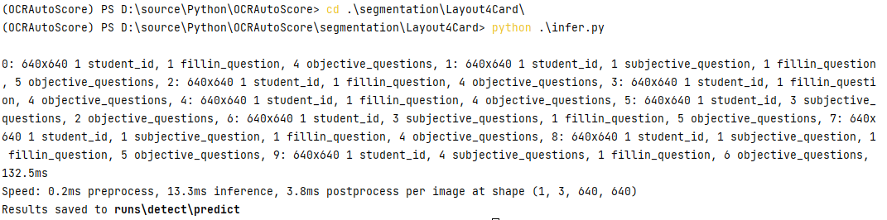

Insert image description here.

The saved image is as follows:

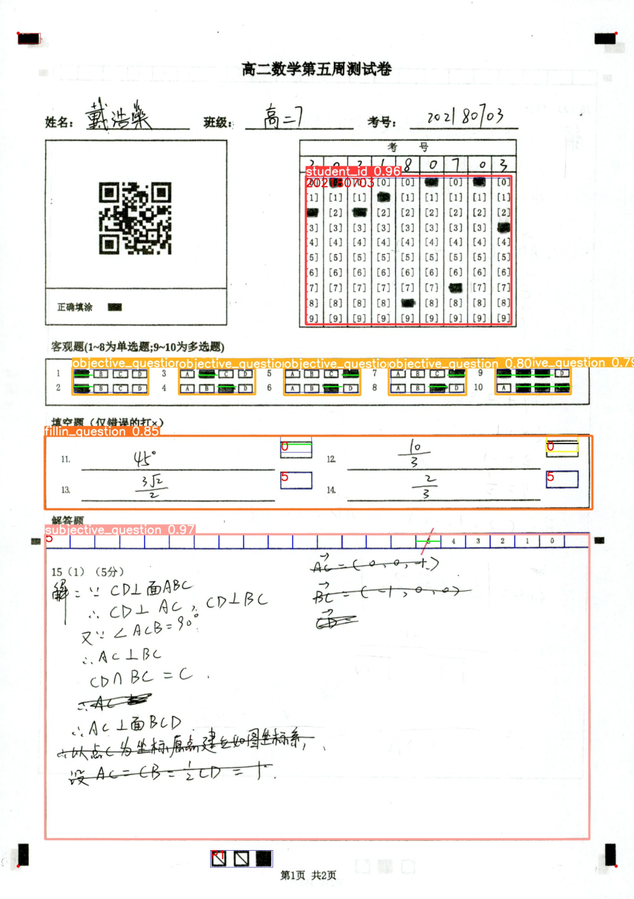

Insert image description here.

## 5 Response Area Division - Submission Breakdown

### 5.1 Tools

`opencv-python 4.5.5.62`

### 5.2 Specific Implementation

(1) Image preprocessing

Convert the input blank question image into a binary image.

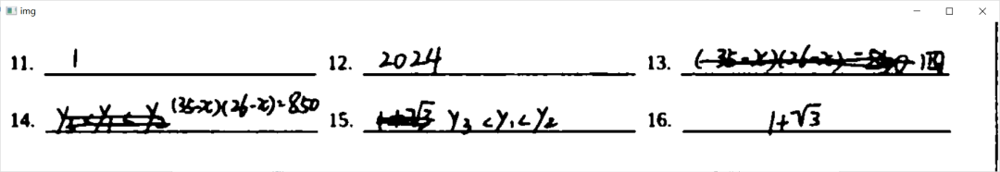

Insert image description here.

(2) Retain the horizontal line

Conduct a dilation operation on the binary image, retaining only the horizontal lines present in the image while erasing any irrelevant strokes.

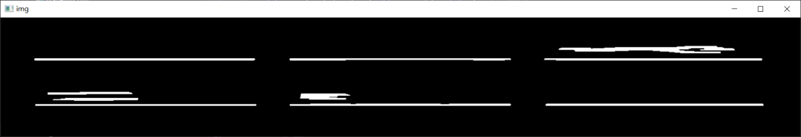

Insert image description here.

(3) The level line to eliminate interference

Sort all the horizontal lines according to their position, with vertical descending order and horizontal ascending order. The sorted result is as follows:

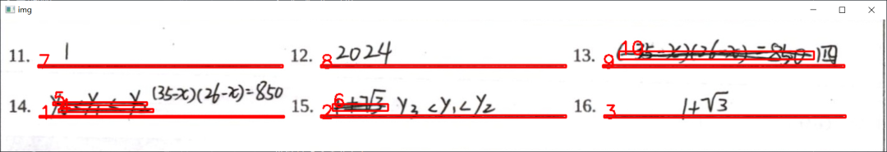

Insert image description here.

Traverse all positioning, obtain the current horizontal line (which is considered as a rectangle with width less than length here, and each side is stored in the form of [x,y,w,h])'s position (x, y), mark the current y coordinate, given hmin and hmax, set the height range limit (y - hmax, y - hmin), record the positioning that falls within the range, if encountering outside the range, update the y coordinate and height limit.
After traversal ends, remove the marked targets, the remaining are the detection targets.

Finally, sort the results in ascending order and iterate through them. The detection results are as follows:

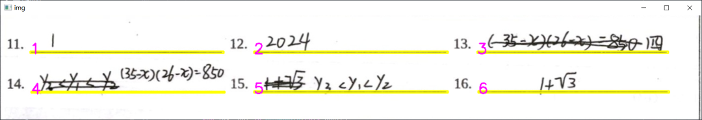

Insert image description here.

Insert image description here.

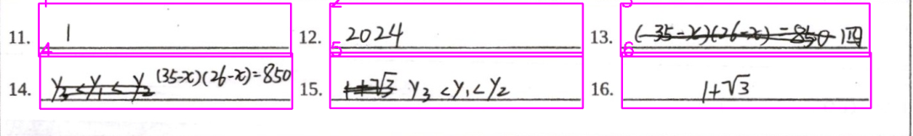

Insert image description here.

## 6. Multiple-Choice Model

### 6.1 Dataset

Use the letters section of the EMNIST dataset, which only contains handwritten letter data and is suitable for use as a single-letter model dataset.

### 6.2 Model Framework

6.2.1 SpinalNet model

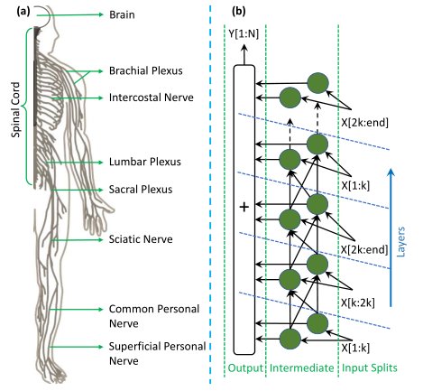

Insert image description here.

Model reference address: `https://github.com/dipuk0506/SpinalNet`

This neural network simulates the somatosensory system of the human body. The main characteristics of this neural network include: neuropil structure (reflected in the middle layer), global influence and local output, etc.

Neural network model flow: input layer -> middle layer -> output layer

The intermediate sublayer receives inputs in the direction of input layer and the previous intermediate sublayer.

6.2.2 WaveMix Model

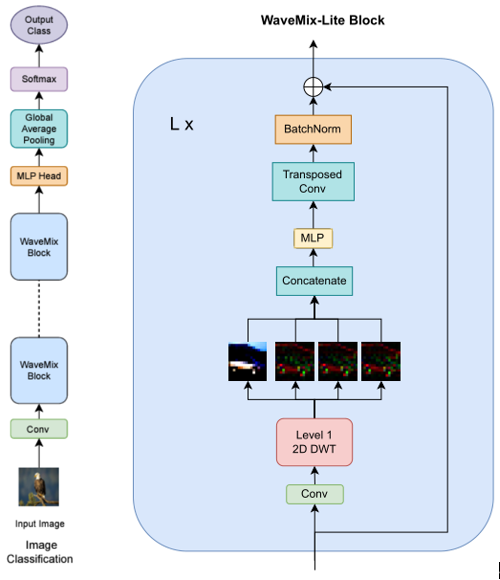

Insert image description here.

Model Reference: `https://github.com/pranavphoenix/WaveMix`

The WaveMix model primarily utilizes 2D discrete wavelet transform (DWT) to mix spatial features, without the need for expanding into image-based self-attention mechanisms, leveraging its own 2D structure to enhance generalization capabilities.

### 6.3 Model Implementation

6.3.1 SpinalNet model

The input layer first feeds the input data into the convolutional layer to extract features. The extracted features are divided into several parts. Passing different intermediate layers. Finally, merge the features. The classification results are input through a linear layer.

6.3.2 WaveMix model

The image first goes through convolutional layers, then enters a series of WaveMix blocks (mainly performs discrete wavelet transform in the WaveMix blocks, and then passes to an MLP layer with GELU, transposed convolution layer and BatchNorm layer in sequence), followed by entering the MLP Head, and finally, it gets the classification output layer through global average pooling layer.

### 6.4 Model Training

Model training address: `https://github.com/YouHui1/Character_Recognition`

```
python train.py -k number
```

When `number == 1`, select the `SpinalNet` model
When `number == 2`, select the `WaveMix` model.

Before training, you can modify the model type, number of training rounds, learning rate, batch size, etc. in `config.py`.

After training, the training logs are stored in the `log` folder, and the model parameters are stored in the `param` folder.

## 7 Fill-in-the-blanks Model - Chinese and English Identification

In the Chinese and English recognition section, we use PaddlePaddleOCR+Clip to implement the recognition + judgment of Chinese and English fill-in-the-blank questions.

### 7.1 PaddlePaddleOCR

PaddlePaddle OCR is a free and open-source OCR project based on the PaddlePaddle deep learning framework. It is developed by  and continuously maintained. PaddlePaddle OCR aims to provide an easy-to-use, high-performance, multilingual support OCR solution.

This project integrates the latest deep learning technology with practical application needs, dedicated to providing developers with a simple and easy-to-use OCR toolkit. It supports scenarios including but not limited to printed text, handwritten text, and scene text recognition.

7.1.1 Reason for selecting PPOCR

PaddlePaddleOCR has achieved excellent results in many OCR competitions, demonstrating good generalization capabilities and performance. It is widely used in multiple fields including intelligent office, finance, healthcare, education, etc.

PaddlePaddleOCR has the following main functions and features:

1.

1. Multi-task Support: PaddlePaddleOCR supports multiple OCR tasks, including text detection, direction classification, and text recognition, enabling flexible handling of various scenarios.

1.

2. Multilingual Support: The project supports recognition in multiple languages, including English, Chinese, French, German, Japanese, etc., suitable for international scenarios.

1.

3. Easy to use: PaddlePaddleOCR provides rich API interfaces and pre-trained models, allowing developers to quickly get started and meet their custom needs.

1.

4. High Performance: The project integrates the latest deep learning technologies, including Convolutional Neural Network (CNN) and Long Short-Term Memory Network (LSTM), to ensure high recognition accuracy and performance.

1.

5. Real-time: PaddlePaddleOCR, while ensuring recognition accuracy, focuses on real-time performance, meeting the OCR needs in real-time scenarios.

Through these features and capabilities, PaddlePaddleOCR provides developers with an efficient, user-friendly, and scalable OCR solution. After our research, it is **the best open-source project for Chinese handwritten font recognition**.

7.1.2 Basic Structure of PPOCR

The project architecture of PaddlePaddleOCR mainly includes the following parts:

1.

1. Text Detection: The text detection module is responsible for identifying the text regions in an image. PaddlePaddleOCR offers various detection algorithms, such as DB (Differentiable Binarization) and EAST (Efficient and Accurate Scene Text Detector), to meet the detection needs in different scenarios.

1.

2. Direction Classification: The direction classification module is used to determine the direction of the detected text area, mainly for processing rotated text. This helps to align the text area to a unified direction, preparing for subsequent text recognition.

1.

3. Text Recognition: The text recognition module is responsible for extracting textual information from the corrected text area. PaddlePaddleOCR employs advanced algorithms such as CRNN (Convolutional Recurrent Neural Network) to achieve high-accuracy character recognition.

1.

4. Model Training and Optimization: PaddlePaddleOCR provides a rich set of pre-trained models and training scripts, supporting users to train their models based on their own datasets. Additionally, the project also offers model optimization tools to help users reduce model complexity while maintaining accuracy and improve inference speed.

1.

5. Deployment: PaddlePaddleOCR supports multiple deployment methods, including Python API, C++ API, and server-side deployment. The project provides easy-to-use deployment tools and tutorials, enabling the OCR function to be easily integrated into various applications.

1.

6. Tools and API: PaddlePaddle OCR offers a variety of tools and APIs to help users quickly get started with the project and implement custom features. For example, the project provides visualization tools that facilitate users in analyzing detection and recognition results.

This architecture ensures that PaddlePaddleOCR can adapt to the text recognition needs of different scenarios, while being easy for developers to use and customize.

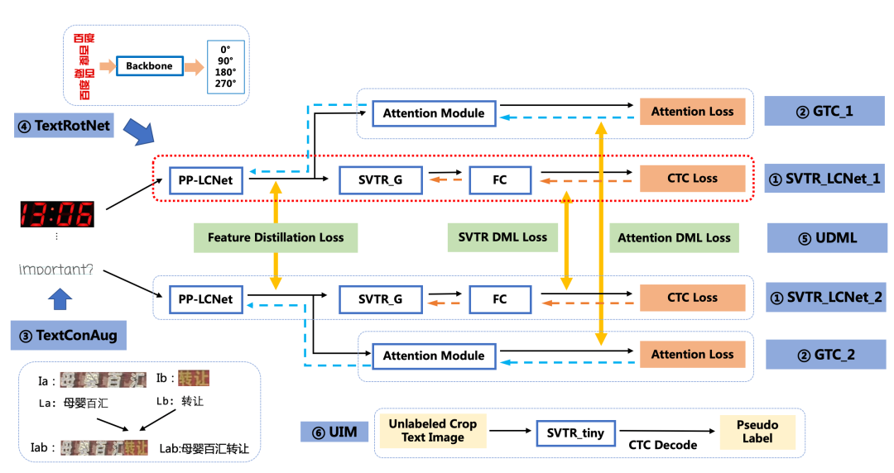

Insert image description here.

7.1.3 Pre-trained Models

PaddlePaddle OCR offers a variety of pre-trained models to allow users to select the appropriate model based on their needs. These pre-trained models cover various text detection and recognition algorithms, including the following:

1.

1. Text Detection Pre-trained Models: PaddlePaddleOCR provides pre-trained models for different text detection algorithms, such as DB (Differentiable Binarization) and EAST (Efficient and Accurate Scene Text Detector).

1.

2. Direction Classification Pre-trained Model: The project provides a direction classification pre-trained model for determining the direction of detected text regions.

1.

3. Text Recognition Pre-trained Models: PaddlePaddleOCR provides various pre-trained models for text recognition tasks, such as CRNN (Convolutional Recurrent Neural Network). These models support multiple languages, including English, Chinese, Japanese, etc.

These pre-trained models provide a solid starting point for developers, allowing users to fine-tune them (Fine-tuning) to suit their specific tasks and datasets. In practical applications, selecting the appropriate pre-trained model can significantly reduce training time and enhance model performance.

Pre-trained models can be downloaded from the PaddlePaddle repository. Below is a direct quote from the PaddlePaddle repository, where we are using the `English ultra-lightweight PP-OCRv3 model` and `Chinese and English ultra-lightweight PP-OCRv3 model (16.2M)` lightweight models.


Model introduction


Model name


Recommended scene


Detection model


Direction classifier


Recognition model


Chinese and English ultra-lightweight PP-OCRv3 model (16.2M)


ch_PP-OCRv3_xx


Mobile & Server

inference model

/ trained model

inference model

/ trained model

inference model

/ trained model


English ultra-lightweight PP-OCRv3 model (13.4M)


en_PP-OCRv3_xx


Mobile & Server

inference model

/ trained model

inference model

/ trained model

inference model

/ trained model


Chinese and English ultra-lightweight PP-OCRv2 model (11.6M)


ch_PP-OCRv2_xx


Mobile & Server

inference model

/ trained model

inference model

/ trained model

inference model

/ trained model


Chinese and English ultra-lightweight PP-OCR model (9.4M)


ch_ppocr_mobile_v2.0_xx


Mobile & server

inference model

/ trained model

inference model

/ trained model

inference model

/ trained model


Chinese and English general PP-OCR model (143.4M)


ch_ppocr_server_v2.0_xx


Server

inference model

/ trained model

inference model

/ trained model

inference model

/ trained model


### 7.2 Clip

Clip is an AI model developed by OpenAI, characterized by its advanced capabilities in visual and language understanding. The project aims to create an AI system capable of comprehending image content and integrating it with natural language descriptions. Clip achieves the integration of computer vision and natural language processing, providing robust performance for a variety of tasks.

The name "Clip" originates from "Contrastive Language-Image Pretraining," indicating that this model is pretrained on a large amount of text and image data to learn how to link language and image information. This enables Clip to perform functions such as image classification, generating text descriptions, and generating images from text descriptions. The core goal of Clip is to achieve more intelligent and flexible AI applications by integrating the understanding of vision and language together.

7.2.1 Reason for selecting Clip

The foundation of the Clip model is based on the Transformer architecture, combining computer vision (CV) with natural language processing (NLP) techniques. It learns to connect images and natural language through extensive pre-training using a large number of image-text pairs.

During the training process, Clip employs a method known as contrastive learning. The essence of contrastive learning lies in enabling the model to learn to distinguish and correlate correct image-text pairs while suppressing irrelevant combinations. Specifically, the model needs to differentiate between positive examples (matched image-text pairs) and negative examples (mismatched image-text pairs), and enhance the similarity of positive examples through an optimization process while reducing the similarity of negative examples.

After training, Clip can perform multiple tasks such as image classification and text-to-image generation. When performing these tasks, Clip calculates the similarity between the given image and the natural language description. For example, in an image classification task, Clip calculates the similarity between the input image and each text description of a category, and selects the category that is most similar to the input image as the prediction result.

Clip not only handles predefined classification tasks but also flexibly processes natural language queries provided by users without additional training. This makes Clip highly versatile and scalable in the fields of computer vision and natural language processing.

**Our cloze test identification, if only using CV methods, may result in a low accuracy. However, since we are aware of the answers to the cloze questions, combining the semantics of the answer with the semantics of the student's handwritten responses can achieve a second-level check, significantly improving accuracy (according to our few sample tests, the known accuracy is 100%).**

7.2.2 Basic Structure of Clip

The basic structure of the Clip model consists of two main components: a visual encoder and a text encoder. Both encoders are based on the Transformer architecture, enabling the model to process both image and natural language data simultaneously.

1.

1. Visual Encoder: The task of a visual encoder is to transform an input image into a vector with high-level feature representations. This is typically accomplished by using models similar to ViT (Vision Transformer). A ViT model divides the input image into multiple small patches, then flattens and linearly embeds each patch into a vector. These vectors are fed into a Transformer layer for encoding, ultimately outputting a vector that represents the entire image.

1.

2. Text Encoder: The text encoder utilizes pre-trained transformer models such as BERT or GPT to process natural language. The text encoder takes a text sequence (e.g., words or characters) as input and converts it into a high-dimensional vector. This vector contains the semantic information within the input text.

Clip, by jointly training a vision encoder and a text encoder, has learned to link images with natural language. This is achieved through contrastive learning, where Clip needs to distinguish between correct image-text pairs (positive examples) and incorrect ones (negative examples), and optimize the similarity between these two types of pairs.

7.2.3 Pre-trained Models

During the pre-training phase, the Clip model is trained with a large amount of image-text pairs to learn to associate visual information with natural language. These datasets typically include images from multiple domains such as internet images, artworks, satellite images, and text descriptions associated with these images. Such datasets help the model capture rich knowledge in both visual and linguistic aspects during training.

The objective of pre-training is to teach Clip how to distinguish between correct image-text pairs (positive examples) and incorrect image-text pairs (negative examples) through contrastive learning. During the training process, Clip needs to learn to enhance the similarity between positive examples while reducing the similarity between negative examples. To achieve this goal, Clip employs an optimization method known as a "contrastive loss function" during the pre-training phase.

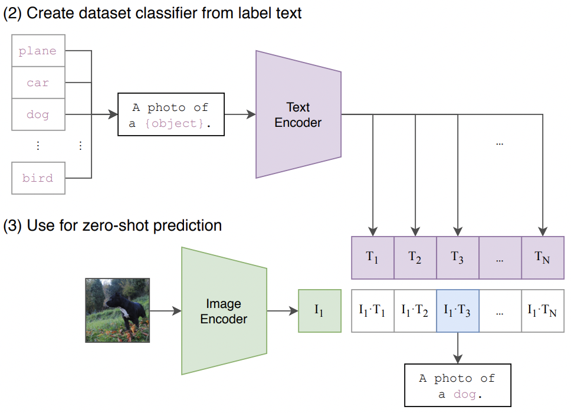

Insert image description here.

Through such pre-training, Clip has learned how to represent images and text as vectors in a similarity space, making related image and text vectors close together in this space while unrelated ones are far apart. This enables Clip to handle tasks in vision and language, such as image classification, text generation, and text-to-image generation.

After pre-training, Clip can be directly applied to various tasks without the need for task-specific fine-tuning. This makes Clip highly versatile and scalable in the fields of computer vision and natural language processing.

In our project, we use the pre-trained model weights from Hugging Face's `openai/clip-vit-large-patch14`.

### 7.3 PPOCR + Clip in the Application of Fill-in-the-Blank Model

The model we previously used was PaddleOCR, which has good recognition effects on images with clear handwriting. However, if the image resolution is poor or there are situations such as smudging or indistinctness, it is very likely to fail.


Insert image description here.

The word is "nationally," but due to resolution and smudging, OCR was recognized as "rationally."

This week, I came up with a solution using PaddleOCR + clip for the judgment of fill-in-the-blank questions. The pseudocode flow is as follows:

```
answer = getanswer() # Get the correct answer
predict = paddleocr(img) # PassedOCRGet the predicted text
if (answer == predict):
<Correct>
else:
prompt_1 = "A picture with the text \"{answer}\""
prompt_2 = "A picture with the text \"{predict}\""
prompt_other = "A picture with the other text"
output = clip(prompt_1, prompt_2, prompt_other, img)
if (output == 0): # The first text has the highest probability.
<Correct>
else:
<Error>
```

In summary, we use Clip as a quality control officer after the OCR model. If the prediction result and the answer are different, we let Clip make the judgment. Which string, `predict` or `answer`, is closest to the image?

Based on my personal testing, without a dataset, I manually created 9 low-resolution and ambiguous English word images. Using only PaddleOCR alone achieved a 3/9 accuracy rate, while using PaddleOCR + clip achieved a 9/9 accuracy rate. Given this is an extremely challenging test, I believe that PaddleOCR + clip can meet practical needs.

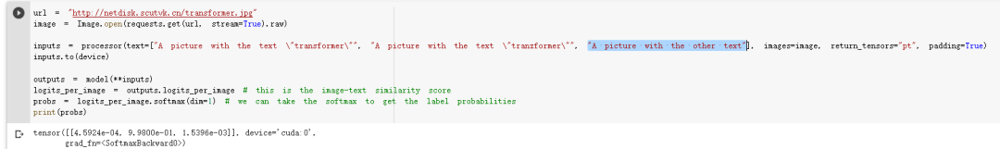

Insert image description here.

### 7.4 Examples

You can run our PPOCR + Clip model for fill-in-the-blank questions individually in the project directory at `scoreblocks/fillblankmodel.py`. Alternatively, you can visit the repository's URL to view the model. Some of our model's source code is as follows:

```
class model:
def __init__(self, language:str="en"):
"""
:parameter language: the language of the text, `ch`, `en`, `french`, `german`, `korean`, `japan`, type: str
"""
def recognize_text(self, _img:Image):
"""
Predict the text from image
:parameter img: image, type: np.ndarray
:return: result, type: tuple{location: list, text: str}
"""
def judge_with_clip(self, _answer:str, _predict:str, _img:Image):
"""
Use clip to judge which one is more similar to the Image
:parameter answer: the answer text, type: str
:parameter predict: the predict text, type: str
:parameter img: image, type: np.ndarray
:return: result, the index of the more similar text, type: int
"""
if __name__ == "__main__":
"""
For testing functions
"""
debug = True
import paddle
print(paddle.device.is_compiled_with_cuda())
model = model()
while True:
img_path = input("Please enter the image path: ")
answer = input("Please enter the correct answer: ")
img = Image.open(img_path)
predict = model.recognize_text(img)[1]
print("Prediction result: ", predict)
if (predict != answer):
print("Correct result:", answer)
index = model.judge_with_clip(answer, predict, img)
print("Judgement Result: ", (answer, predict, "error")[index])
```

After running, we only need to input the path of the image to be detected and the correct answer to conduct the correction.

How to run:

```
cd .\scoreblocks\
python .\fillblankmodel.py
```

Test Images:


Insert image description here.

Run Result:

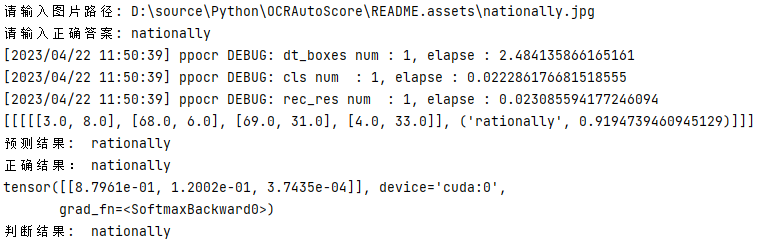

Insert image description here.

It is evident that PPOCR predicts "rationally," while our Clip model ultimately chooses "nationally" under the choices of "rationally" and "nationally."

## 8 Fill-in-the-blanks Model - Formula Recognition

### 8.1 Architecture

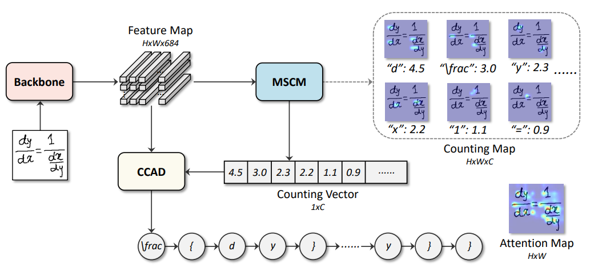

Insert image description here.

In this project, we integrated the CAN (Counting-Aware Network) proposed by Li B (2022), achieving recognition of more complex formulas such as logarithms and exponential functions. The CAN integrates two tasks: handwritten formula recognition and symbol counting. Specifically, a weakly supervised symbol counting module was used, which can predict the number of each symbol class without knowing the position of symbols.

### 8.2 Implementation

Training Part
In the recognition of mathematical formulas, we refer to the method used by CAN (Li B et al) which employs an attention mechanism and combines the encoder and decoder methods, using DenseNet as the encoder. During the training process, we first input images into DenseNet to obtain image features, then feed these features into three pre-set decoders respectively. The first two decoders generate counting_loss, while the last decoder generates word_loss, through which we train different decoders with these three losses.
Dataset
We use the CROHME dataset for formula training. The CROHME dataset is in a pkl file format, and we read it using Python's PIL library.
Prediction
During the prediction of formulas, we predefine a dictionary and match the predicted probabilities with characters in the dictionary using the encoder-decoder, achieving the recognition of handwritten formulas, as shown in the figure below, where we map the predefined characters to the dictionary.

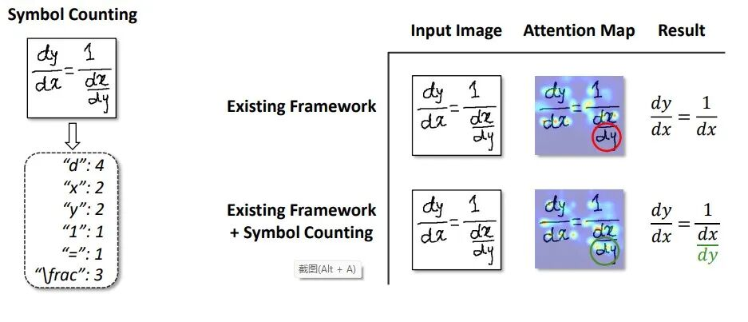

Insert image description here.

### 8.3 Operation

This project requires PyTorch 1.10.2+Python 3.6.

training:

```
cd scoreblocks/CAN
source activate pytorch
python train --dataset=CROHME
```

test:

```
python inference.py
```

## 9 Essay Scoring Model

Referenced from the paper "On the Use of Bert for Automated Essay Scoring: Joint Learning of Multi-Scale Essay Representation - ACL Anthology" by NAACL.

### 9.1 Original Model Structure

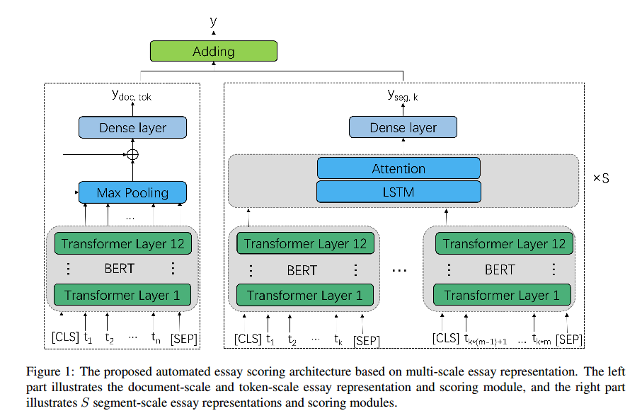

Insert image description here.

The methods used include multi-scale BERT, multiple losses, and transfer learning. The original model repository is: lingochamp/Multi-Scale-BERT-AES: Demo for the paper "On the Use of BERT for Automated Essay Scoring: Joint Learning of Multi-Scale Essay Representation" (github.com).

### 9.2 Model Improvement

Since the original model is completely open-source, many parts were completed by ourselves, perhaps due to our limited capabilities, we did not achieve the results as good as those mentioned by the author on the ASAP dataset.

After the ablation experiment, we replaced the multi-scale bert-base model with a single debertav3-large model. We used `(0.2 + 0.8 * cos(epoch/total_epoch * pi))MSE + (1 - 0.8 * cos(epoch/total_epoch * pi))*(RankLoss + CosLoss)` to replace the original loss function. Due to dataset constraints, we did not use transfer learning. Other parts of the code were also modified, but not significantly.

The improved model, we named it MSPLM, can be found in our repository: vkgo/MSPLM (github.com), where you can obtain the code and experimental results.

## 10 WebUI

### 10.1 Framework

-

• Front-end framework: React + Typescript


Insert image description here.

-

• Backend Framework: Django - A Python-based backend framework

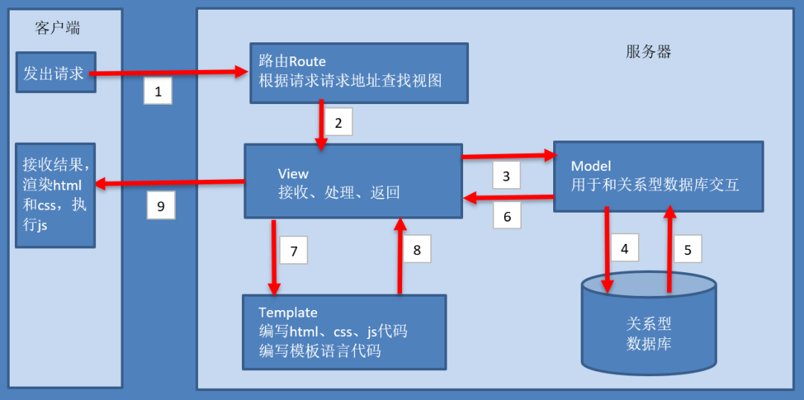

Insert image description here.

10.2 Implementation

##### Login and Registration

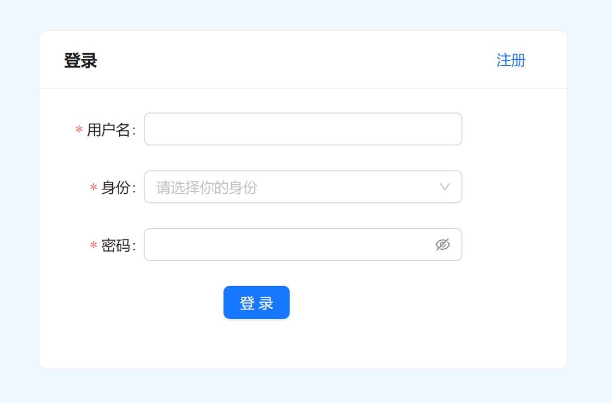

Insert image description here.

-

• The front-end uses the Ant Design component library's Form component, where users fill out forms and then make requests to the backend.

-

• Backend query whether the Student and Teacher data tables exist corresponding data. If the query is empty, return an error "Invalid username or password". If not empty, return a message indicating successful login.

-

• If login is successful, we will store user information in the session.

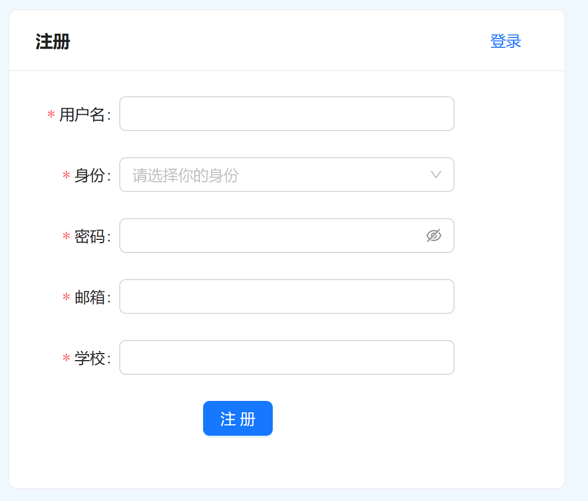

Insert image description here.

-

• The front-end uses the Ant Design component library's Form component, where users fill out forms and then make requests to the backend.

-

• Backend checks if there is corresponding data in the Student and Teacher tables based on the username. If the query returns an empty result, it means "Registration successful" is returned; otherwise, an error message "This username has already been registered" is returned.

-

• If login is successful, we will store user information in the session.

##### Test Paper List

The exam list appears on both the student and teacher pages. On the student interface, it is a question bank, while on the teacher's interface, it includes all the exams uploaded by teachers.

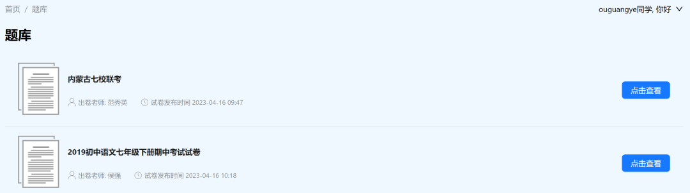

Insert image description here.

The frontend requests the backend interface, and the backend queries the Paper data table to return the corresponding information.

##### Teacher uploads exam papers

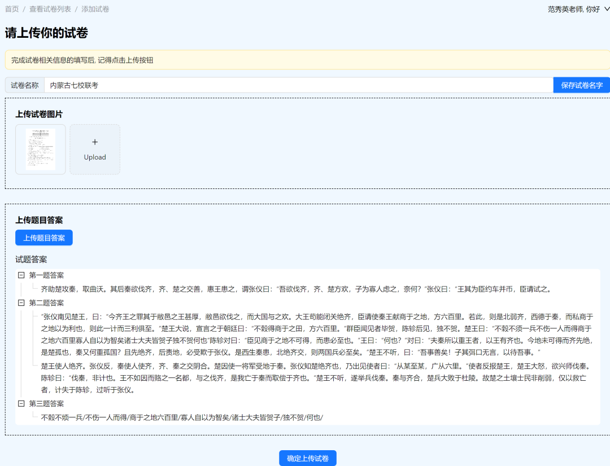

Insert image description here.

-

• When the page is first loaded, the frontend requests an interface to create a test paper.

-

• This section contains three pieces of information: the exam name, the exam image, and the exam answer. After filling in the information, request the corresponding interface from the backend to save the corresponding information.

-

• If the user has not clicked the save button, after exiting the page, the frontend will request an interface to delete the exam paper.

##### Student uploads answer images

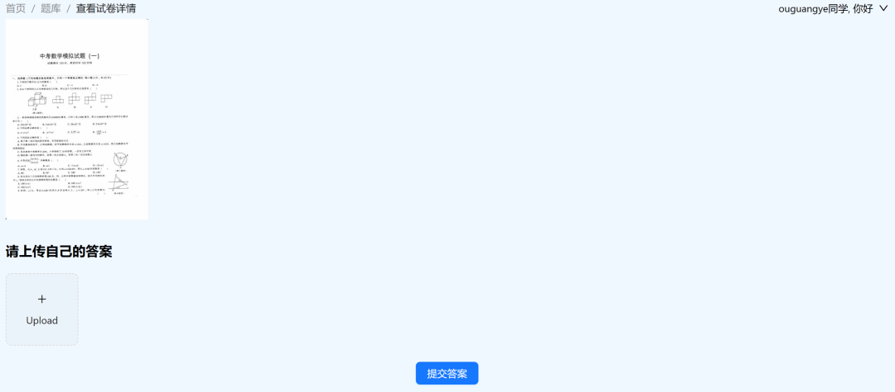

Insert image description here.

-

• Upon entering the page, the frontend requests the backend based on the paper ID, and the backend returns the image of the exam paper.

-

• Students upload their own answers.

-

Backend calls the model in score.py for scoring and returns the score.

10.3 Operation

-

• Frontend Running
Enter the score_web folder and run: ````shell
npm start`

```

```

-

• Backend Running
Enter the score_server folder and run the server with ````shell
python manage.py runserver`

```
```


## Payment

Here is a pay link on Stripe ( https://buy.stripe.com/3cs8yP7sY87d0vu9AB ). Please contact me lonlonago@foxmail.com after funding $89, and I will send you a complete data files , thank you!


